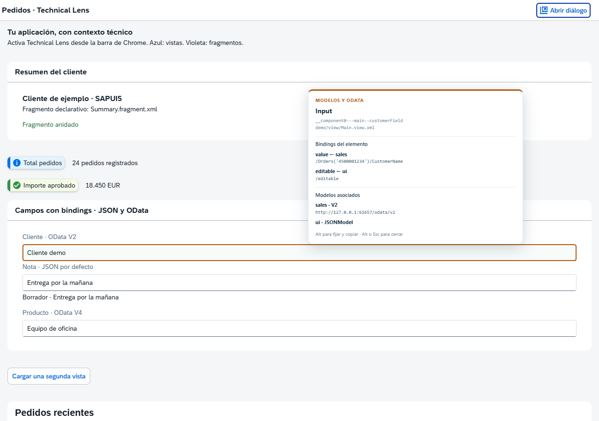
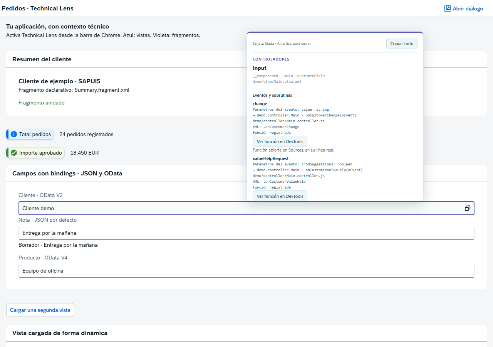

# UI5 Technical Lens

Extensión de Chrome (Manifest V3) que muestra los ficheros técnicos de las vistas y fragmentos SAPUI5/OpenUI5 sobre los elementos de la aplicación actual.

Creada por **Jesús Franco Guzmán** · [LinkedIn](https://es.linkedin.com/in/jesus-franco-guzman).

[Descargar la extensión 1.5.1 lista para instalar](https://github.com/jesusfrguz/ui5-technical-lens/raw/refs/heads/main/downloads/UI5-Technical-Lens-1.5.1.zip).

La versión **1.5.1** corrige **Ver función en DevTools**: resuelve el recurso cargado y la línea/columna del método y solicita esa posición explícitamente a Sources. También corrige la selección de iframes con la misma URL. **Alt** fija la tarjeta para seleccionar y copiar; **Alt o Esc** la cierran de forma independiente. Para actualizar, sustituye los archivos de la instalación descomprimida por los del ZIP nuevo, pulsa **Recargar** en `chrome://extensions`, recarga la app y cierra/vuelve a abrir DevTools.

## Vista de ejemplo



Captura de la app utilizada en las pruebas: al señalar el campo **Cliente · OData V2**, el inspector muestra sus bindings, los modelos `sales` y `ui`, y el servicio asociado. Los datos y servicios de esta demo son de ejemplo.

## Instalación

1. Descomprime `UI5-Technical-Lens.zip` si utilizas el paquete de `dist`.
2. Abre `chrome://extensions` en Chrome.
3. Activa **Modo de desarrollador**.
4. Pulsa **Cargar descomprimida** y selecciona la carpeta que contiene `manifest.json`: esta carpeta del proyecto o `dist/UI5-Technical-Lens`.
5. Fija **UI5 Technical Lens** en la barra de extensiones.
6. Abre tu aplicación SAPUI5 en una URL HTTP/HTTPS y pulsa el icono de la extensión.

Chrome no instala este ZIP directamente ni requiere generar un CRX. Para instalar en una organización con restricciones, consulta sus políticas de extensiones. Se requiere Chrome/Chromium 114 o posterior para navegar también por columna.

## Uso

- **Mostrar nombres técnicos** activa/desactiva la superposición en la pestaña actual.
- **Vistas**: bordes azules y rutas como `mi/app/view/Main.view.xml`.
- **Fragmentos**: bordes violetas discontinuos como `mi/app/fragment/Filters.fragment.xml`.
- **Controladores**: muestra el controlador asociado a cada vista o fragmento, con nombre, ruta técnica, vista de origen y tipo de asociación. Funciona de forma independiente de los flags de vistas, fragmentos, modelos y OData. Los resultados aparecen en el panel con la marca **C**, se pueden buscar por nombre/ruta y se muestran al señalar los elementos de la vista o fragmento. Alt fija la tarjeta para copiar todos sus detalles.
- **Modelos**: activa una tarjeta al pasar el ratón sobre una vista/ventana o campo con información de modelo. Incluye modelo por defecto y modelos con nombre, tipo, propiedad, ruta relativa, contexto y ruta resuelta. No añade etiquetas permanentes a todos los campos.
- **OData**: activa la información OData V2/V4 al pasar el ratón, con modelo, servicio y origen `dataSource` en el detalle del panel cuando está disponible. Es independiente del flag de modelos. Al activar ambos, se muestra una única tarjeta del elemento señalado.
- Solo se resalta el elemento bajo el ratón. La tarjeta cambia al moverte a otro control y desaparece al salir de él o de la página. Los campos sin binding/modelo propio no se atribuyen al modelo de su ventana. Durante la inspección normal, la tarjeta deja pasar los clics y se coloca dentro de la ventana del navegador.
- **Señala el elemento y pulsa Alt para fijar la tarjeta**. No necesitas hacer clic en el control ni mantener pulsada la tecla. La tarjeta queda inmóvil y pasa a ser interactiva: puedes entrar con el ratón, seleccionar texto, desplazarte por el contenido y copiar con **Ctrl+C**. **Ctrl+A**, cuando el foco está dentro de la tarjeta, selecciona únicamente su contenido. **Copiar todo** copia sus detalles técnicos completos. **Alt otra vez o Esc** cierran la tarjeta de forma independiente, sin combinarlas. Esc también oculta una tarjeta sin fijar. Mientras cierra una tarjeta, la extensión consume la pulsación completa de Esc para que no cierre además el popup de UI5, incluidos los eventos repetidos al mantener la tecla. Sin tarjeta abierta, Esc conserva el comportamiento de la app. Alt puede volver a fijar el mismo elemento después de cerrarlo con Esc.
- La tarjeta normal resume hasta cuatro bindings y cuatro modelos. Al fijarla, muestra todos con desplazamiento y conserva una instantánea: las actualizaciones automáticas de la app no reemplazan el texto que estás seleccionando. La fijación termina al liberar, cambiar los flags de datos o desactivar la extensión. El atajo se coordina entre marcos de la pestaña, también cuando el campo señalado está en un iframe y el foco del teclado está fuera de él.
- El detalle completo también permanece disponible en el panel de la extensión; **Localizar** permite previsualizar el control durante unos segundos.
- En las filas de modelos/OData, despliega **Modelos y bindings** para ver todos los detalles. La búsqueda incluye campos, modelos, tipos, rutas y servicios. Los botones permiten copiar la información y localizar el control.
- **Nombre corto** muestra solo el nombre de fichero en las etiquetas.
- El listado permite buscar por nombre, ruta o ID, copiar una ruta y localizar su elemento.
- **Actualizar detección** refresca el listado. Las etiquetas se actualizan automáticamente durante la navegación, el desplazamiento, las cargas y los cambios del DOM.
- **Recargar app para capturar fragmentos** activa la captura y recarga la pestaña. Guarda antes cualquier cambio pendiente en la app: se trata de una recarga normal de Chrome.
- El estado es independiente por pestaña, se mantiene al recargar y se elimina al cerrar esa pestaña o terminar la sesión del navegador.

Las etiquetas no interceptan clics ni teclado. Los fragmentos que devuelven varios controles raíz se marcan sobre cada raíz. Los controles ocultos permanecen en el listado pero solo reciben una etiqueta cuando tienen DOM visible. Los diálogos se identifican al abrirlos.

La cabecera muestra el título principal y el ID de la app. Consulta los componentes registrados, sus manifiestos y los recursos de traducción ya disponibles; prioriza los componentes visibles de aplicación frente al shell de Fiori. Si el título aún no está disponible, muestra el título de la pestaña y vuelve a comprobarlo mientras el panel esté abierto. El título largo se muestra en varias líneas.

**Disponible** indica que una ventana recibe un modelo, por asignación o herencia; no implica que todos sus campos usen ese modelo. **Binding de control** identifica una propiedad o contexto realmente enlazado. En un binding compuesto se muestran sus partes. Si una ruta relativa no tiene contexto, se indica que está pendiente; no se inventa una ruta absoluta.

La inspección usa metadatos de binding/modelo del cliente: no lee valores de campos, no ejecuta `read`, `refresh`, `requestObject` ni solicitudes adicionales de datos o `$metadata`. Muestra servicios sin credenciales, query ni fragmento URL. Las rutas de contexto pueden incluir claves de entidad. No relaciona llamadas OData realizadas manualmente por `fetch`, AJAX o lógica que no tenga un modelo/binding asociado al control. Los modelos declarados pero aún no instanciados no se presentan como modelos ligados a un campo.

Se usan APIs públicas de bindings y modelos; para enumerar nombres de modelos se consultan de forma defensiva los mapas internos `oModels` y `oPropagatedProperties.oModels`, porque no existe una enumeración pública universal en todas las versiones. OData V2 puede requerir leer `sServiceUrl`; V4 utiliza `getServiceUrl()` si está disponible. Un cambio interno de UI5 puede requerir adaptar estas lecturas. Al inspeccionar listas muy grandes, conviene activar únicamente el tipo de etiqueta necesario.

## Eventos y navegación al código

Con **Controladores** activo, señala un botón, un matchcode o cualquier control con eventos registrados. La tarjeta muestra eventos como `press`, `change` y `valueHelpRequest`, los nombres/tipos de sus parámetros declarados y los métodos/subrutinas asociados, con los argumentos formales recuperables. El panel incluye estas entradas con la marca **E** y permite buscar por evento o handler. Se muestran todos los listeners registrados para cada evento.



1. Señala el control y pulsa **Alt** para fijar la tarjeta sin hacer clic en la app.
2. Pulsa **Ver función en DevTools** junto al método. También está disponible al desplegar **Eventos, parámetros y subrutinas** en el popup.
3. Si DevTools está cerrado, abre **F12** o **Ctrl+Mayús+I**. La última función solicitada queda pendiente y se abre al conectar.
4. DevTools abre **Sources** en el recurso y coloca el cursor en la línea y columna de la función. La tarjeta indica el archivo y las coordenadas enviadas. La extensión no ejecuta el handler ni añade breakpoints.

Chrome exige que el usuario abra DevTools. Después de actualizar la extensión, cierra y vuelve a abrir DevTools si ya estaba abierto. La navegación obtiene el texto de la función registrada desde el ID exacto del marco, resuelve la URL del módulo con el cargador UI5 y compara la función completa con los scripts ya disponibles en DevTools. Un analizador JavaScript descarta comentarios y cadenas, y distingue métodos con cuerpos idénticos por su propiedad y módulo. Solo se navega si existe una ubicación única, mediante `chrome.devtools.panels.openResource(url, línea, columna)`; no se usa `inspect(fn)` como confirmación de navegación ni se solicita permiso `debugger`.

Se lee defensivamente el registro interno `mEventRegistry` y los metadatos de eventos de UI5. Solo se muestran eventos con listeners registrados; no se registra actividad, no se interceptan valores disparados y no se leen `oData` ni parámetros de negocio. Los nombres de argumentos son orientativos si el código está minificado. En handlers XML con argumentos se resuelve la ruta del método en el receptor actual, sin evaluar expresiones. Las declaraciones XML se resumen como `.metodo(…)`, sin copiar sus valores literales. Si no se puede resolver un alias/módulo o wrapper, se conserva la función registrada y se indica así. No se inspeccionan listeners DOM ajenos a UI5 ni se reconstruye la cadena de llamadas que pueda ejecutar el handler.

En iframes se usa el ID del marco para recuperar la función, por lo que varias ventanas con exactamente la misma URL no se confunden. Una recarga invalida las referencias anteriores y requiere volver a señalar el control. Si no se encuentra el código, es nativo/bound o hay varias ubicaciones posibles, se indica el motivo y no se abre un archivo arbitrario. Los bundles se abren en la ubicación de la función dentro del recurso cargado. El formateo automático y los source maps de DevTools pueden cambiar las coordenadas visibles respecto al archivo original: el cursor se revela en la posición correspondiente.

## Detección y límites

Los controladores de las vistas se obtienen de su instancia real mediante `getController()` y sus metadatos. Para fragmentos se conserva el controlador recibido durante su creación, incluidos `Controller.loadFragment()` y fragmentos declarativos; si falta esa información se consulta la vista contenedora más cercana. Un fragmento no tiene un controlador propio de MVC. Si recibe un objeto anónimo de handlers, o no hay controlador, se indica expresamente y no se inventa un fichero.

También se muestran clases base y extensiones de controlador que estén identificadas en el runtime. Se consultan módulos ya cargados para reconocer tanto `Main.controller.js` como archivos base o extensiones que usen `.js`. Cuando solo se puede derivar una ruta del namespace, se marca **convención UI5** en el detalle. Son rutas lógicas de recursos; no se descargan ni se ejecutan los archivos para inspeccionarlos. La lectura opcional de extensiones usa el mapa interno `_sapui_Extensions` de forma defensiva; extensiones anónimas o cargadores personalizados pueden no ofrecer un nombre recuperable.

Las vistas se descubren en el registro de controles de UI5 y se identifican con `getViewName()`. También se consulta el componente propietario y su manifiesto para mostrar la app actual. Si no hay manifiesto accesible, se muestra el título de la página.

Los fragmentos no son controles ni conservan necesariamente su nombre de origen en el DOM. La extensión observa su creación con `Fragment.load` y, cuando existe, con el adaptador interno `Fragment.prototype._initCompositeSupport`. Este último permite capturar también fragmentos XML declarativos, anidados y factorías antiguas. Las llamadas conservan el resultado o la promesa original y los errores originales. También se aprovecha `_sapui_declarativeSourceInfo.fragmentName` cuando UI5 lo facilita.

**Activa la extensión y recarga la app para detectar los fragmentos iniciales.** Si un fragmento se creó antes de instalar la captura y UI5 no conserva metadatos de origen, no es posible reconstruir su nombre con certeza. El arranque muy temprano puede adelantarse a la captura; abre de nuevo ese fragmento o recarga. No se inventan nombres a partir de IDs. Fragmentos definidos con XML/JS inline sin nombre de recurso no tienen fichero identificable.

Las rutas son **nombres de recurso de UI5**, derivados de su namespace y tipo. No representan una ruta absoluta del equipo, el repositorio o el servidor. Los módulos con sintaxis `module:` usan su ruta de módulo. Los recursos empaquetados en `Component-preload.js` conservan su nombre lógico. Los XML transformados por preprocesadores, variantes FE o bibliotecas que no pasan por las factorías observadas pueden carecer de una correspondencia recuperable.

El adaptador de fragmentos usa una API interna que puede cambiar entre versiones. La captura mediante la API pública sigue disponible cuando falta esa API interna; los fragmentos declarativos podrían requerir una adaptación. No se activa el modo de diseño ni se modifica la configuración de arranque de UI5. Las factorías instrumentadas permanecen hasta la próxima recarga, aunque se oculten las etiquetas, para conservar el origen de los fragmentos creados durante la inspección.

Se incluyen marcos HTTP/HTTPS, incluso de otro origen si Chrome concede acceso al sitio. Elige **En todos los sitios** o permite los dominios necesarios desde los permisos de la extensión. Los marcos `about:blank` pueden heredar el acceso. No se inspeccionan páginas internas de Chrome, Chrome Web Store, PDF del navegador, `file://`, shadow roots de la app ni marcos sandbox sin acceso. Si restringes los permisos a sitios concretos, la inspección de un iframe sin permiso puede fallar: concede el acceso a ese origen y vuelve a intentarlo.

Se dibujan hasta **300 regiones visibles por marco** para limitar el coste de la superposición. El listado mantiene todos los ficheros detectados. Elementos que se superponen entre sí, contenido ocluido por otros controles y etiquetas muy próximas pueden requerir desactivar el filtro de vistas o fragmentos para facilitar la lectura. Solo se calcula visibilidad geométrica y CSS, no oclusión por otros controles.

## Privacidad y permisos

La extensión no envía datos, no usa servicios externos ni incluye analítica. Solicita acceso a HTTP/HTTPS para poder detectar UI5 e inspeccionar apps dentro de iframes, `scripting` para consultar el contexto de la app y `storage` para recordar opciones por pestaña durante la sesión. Los scripts se registran al inicio, pero la detección y la instrumentación de UI5 empiezan al abrir el popup o activar las etiquetas. Consulta `PRIVACY.md`.

## Demo y pruebas

Se necesita Node.js para desarrollo; la extensión instalada no lo necesita.

```powershell
npm ci
npm test
npm run demo
```

Abre `http://127.0.0.1:4173`. La demo necesita Internet para cargar SAPUI5 1.120.40 desde `ui5.sap.com`. Incluye un matchcode con eventos de ayuda y cambio, un botón con handler XML parametrizado, una vista inicial, fragmentos declarativos/anidados, un fragmento con varias raíces, un diálogo con `Controller.loadFragment()` y una segunda vista dinámica.

```powershell
npx playwright install chromium
npm run test:browser
npm run test:devtools
npm run package
```

Las pruebas de navegador usan un perfil temporal aislado con la extensión real, sin modificar tu perfil personal de Chrome. Generan capturas en `test-results/`. El paquete de `dist` contiene únicamente los archivos necesarios para la extensión y su documentación; excluye la demo, las pruebas y las dependencias. `npm run test:devtools` abre el frontend real de DevTools en un navegador headless y verifica el archivo y la selección del editor Sources, incluyendo métodos homónimos, cuerpos idénticos, columnas minificadas, sourceURL e iframes de URL idéntica.

Si Windows bloquea el ejecutable descargado de Chromium, se puede usar Edge instalado para la misma prueba: `$env:UI5_TEST_BROWSER = 'msedge'; npm run test:browser`. La verificación realizada en este entorno usó Edge/Chromium con la extensión real y SAPUI5 1.120.x.

Referencias de mantenimiento: [creación de fragmentos en SAPUI5](https://github.com/SAP-docs/sapui5/blob/main/docs/04_Essentials/instantiation-of-fragments-04129b2.md), [implementación de Fragment en OpenUI5](https://github.com/UI5/openui5/blob/master/src/sap.ui.core/src/sap/ui/core/Fragment.js), [Chrome Scripting API](https://developer.chrome.com/docs/extensions/reference/api/scripting), [Chrome openResource](https://developer.chrome.com/docs/extensions/reference/api/devtools/panels#method-openResource), [Chrome recursos de DevTools](https://developer.chrome.com/docs/extensions/reference/api/devtools/inspectedWindow). El analizador Acorn 8.19.0 se distribuye localmente con su licencia MIT en `vendor/acorn.LICENSE`.

## Autor

**Jesús Franco Guzmán**

Perfil profesional y contacto: [Jesús Franco Guzmán en LinkedIn](https://es.linkedin.com/in/jesus-franco-guzman).
