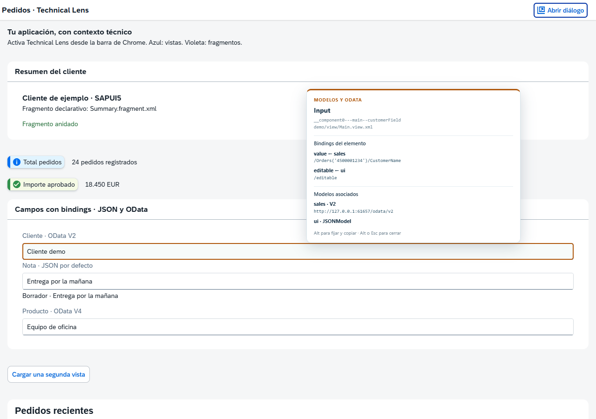
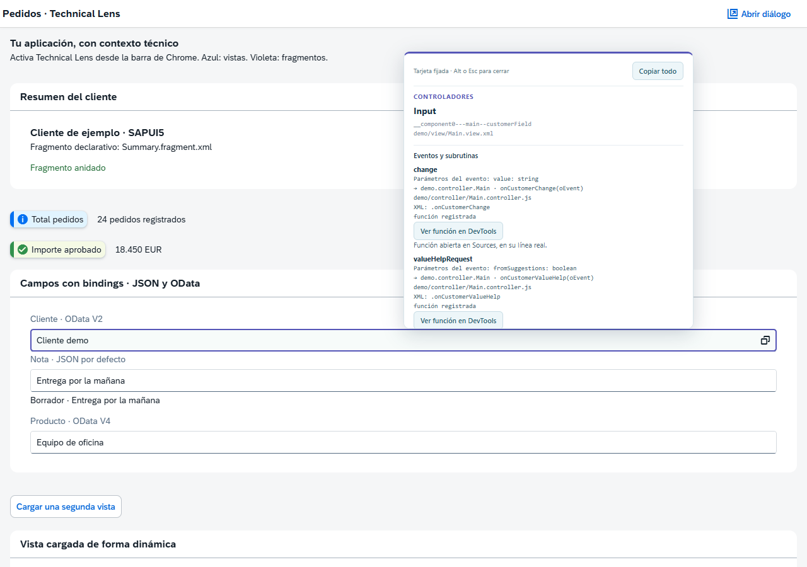

# UI5 Technical Lens

La versión **1.7.10** mejora el rendimiento de la superposición: detiene las comprobaciones de visibilidad al alcanzar 300 regiones visibles, reduce los cálculos de posición de las etiquetas y evita repintados redundantes al recopilar fragmentos declarativos. El inventario conserva todos los elementos detectados.

La versión **1.7.9** comprueba si una app ABAP acaba de cargar recursos con un token distinto del actual del servidor, incluso cuando proceden de la caché del navegador. Lee las URLs de peticiones reales mediante Resource Timing, sin tomar la ruta predicha por el cargador como prueba de la versión ejecutada. Para tokens de aplicación con sufijo (por ejemplo `~token~5`), consulta `ui5_app_info_json?id=<sap.app/id>` y busca el token en la URL de la app o en su hint de componente. Para tokens por archivo, compara cada recurso con su entrada en `sap-ui-cachebuster-info.json`. No compara tokens de aplicación con timestamps individuales.

Comprueba al detectar una aplicación activa o nuevos tokens cargados, y al entrar de nuevo en una app desde otro destino del Launchpad. La detección de navegación, recursos y registro tardío de componentes es local y agrupa los eventos; las comprobaciones repetidas de la misma entrada reutilizan su resultado. **No hay consultas periódicas ni por recuperar el foco**, y cambiar la ruta interna de una misma app no provoca una nueva consulta. **Comprobar cambios** permite solicitar una comprobación nueva manualmente.

Si el token cargado difiere del actual, muestra un aviso y **Recargar Launchpad sin caché**. Guarda el trabajo pendiente: el botón recarga toda la pestaña conservando la URL con `bypassCache: true`, sin borrar cookies ni almacenamiento y sin recargar automáticamente. Funciona con la superposición desactivada y el panel cerrado. Si faltan las URLs de carga (por ejemplo, porque ya salieron del buffer de Resource Timing), no hay tokens comparables en los metadatos de esa versión ABAP, o falla la sesión/red, indica que no puede confirmar la versión; no lo interpreta como una app actualizada. Un token diferente también puede corresponder a una reversión. Si ABAP publica metadatos antiguos, la extensión no puede descubrir el despliegue; la recarga no invalida cachés ABAP, ICM ni Web Dispatcher. Solo consulta recursos del mismo origen del marco que aloja la app.

Extensión de Chrome (Manifest V3) que muestra los ficheros técnicos de las vistas y fragmentos SAPUI5/OpenUI5 sobre los elementos de la aplicación actual.

Creada por **Jesús Franco Guzmán** · [LinkedIn](https://www.linkedin.com/in/jesus-franco-guzman).

[Descargar la última versión lista para instalar](https://github.com/jesusfrguz/ui5-technical-lens/releases/latest/download/UI5-Technical-Lens.zip) · [Versiones y notas de publicación](https://github.com/jesusfrguz/ui5-technical-lens/releases).

La versión **1.7.7** corrige la apertura de vistas y fragmentos XML cuando DevTools no los enumera, especialmente en cargas AJAX y recursos `?eval`. El árbol consulta el inventario real de UI5 y lee cada XML al seleccionarlo, usando primero la caché del navegador. También conserva la petición de apertura durante el arranque y evita actualizaciones causadas por las propias consultas de la extensión.

La versión **1.7.6** optimiza el espacio vertical de UI5 Code con barras y árbol compactos, ayuda desplegable, estados en una barra inferior y menor interlineado. También amplía la navegación con **Ctrl+clic** a variables, constantes y librerías importadas, incluidos sus métodos estáticos y de `prototype`. También busca el texto seleccionado en el visor al pulsar **Ctrl+F** y muestra una lista pulsable de coincidencias al buscar en todos los archivos, con fichero, línea, columna y vista previa. Conserva el árbol lateral, la navegación a definiciones mediante **Ctrl+clic**, el historial y las funciones de inspección anteriores. Para actualizar, sustituye los archivos de la instalación descomprimida por los del ZIP nuevo, pulsa **Recargar** en `chrome://extensions` o `edge://extensions`, comprueba que aparece **1.7.10**, recarga después la pestaña de la app y cierra/vuelve a abrir DevTools. Si cargas `dist/UI5-Technical-Lens`, ejecuta `npm run package` después de cambiar el código para actualizar esa copia.

## Vista de ejemplo



Captura de la app utilizada en las pruebas: al señalar el campo **Cliente · OData V2**, el inspector muestra sus bindings, los modelos `sales` y `ui`, y el servicio asociado. Los datos y servicios de esta demo son de ejemplo.

## Instalación

1. Descomprime `UI5-Technical-Lens.zip` si utilizas el paquete de `dist`.
2. Abre `chrome://extensions` en Chrome.
3. Activa **Modo de desarrollador**.
4. Pulsa **Cargar descomprimida** y selecciona la carpeta que contiene `manifest.json`: esta carpeta del proyecto o `dist/UI5-Technical-Lens`.
5. Fija **UI5 Technical Lens** en la barra de extensiones.
6. Abre tu aplicación SAPUI5 en una URL HTTP/HTTPS y pulsa el icono de la extensión.

Chrome no instala este ZIP directamente ni requiere generar un CRX. Para instalar en una organización con restricciones, consulta sus políticas de extensiones. Se requiere Chrome/Chromium 114 o posterior para navegar también por columna.

## Uso

- **Mostrar nombres técnicos** activa/desactiva la superposición en la pestaña actual.
- **Vistas**: bordes azules y rutas como `mi/app/view/Main.view.xml`.
- **Fragmentos**: bordes violetas discontinuos como `mi/app/fragment/Filters.fragment.xml`.
- **Controladores**: muestra el controlador asociado a cada vista o fragmento, con nombre, ruta técnica, vista de origen y tipo de asociación. Funciona de forma independiente de los flags de vistas, fragmentos, modelos y OData. Los resultados aparecen en el panel con la marca **C**, se pueden buscar por nombre/ruta y se muestran al señalar los elementos de la vista o fragmento. Alt fija la tarjeta para copiar todos sus detalles.
- **Modelos**: activa una tarjeta al pasar el ratón sobre una vista/ventana o campo con información de modelo. Incluye modelo por defecto y modelos con nombre, tipo, propiedad, ruta relativa, contexto y ruta resuelta. No añade etiquetas permanentes a todos los campos.
- **OData**: activa la información OData V2/V4 al pasar el ratón, con modelo, servicio y origen `dataSource` en el detalle del panel cuando está disponible. Es independiente del flag de modelos. Al activar ambos, se muestra una única tarjeta del elemento señalado.
- Normalmente se resalta el elemento bajo el ratón. La tarjeta cambia al moverte a otro control y desaparece al salir de él o de la página. Los campos sin binding/modelo propio no se atribuyen al modelo de su ventana. Durante la inspección normal, la tarjeta deja pasar los clics y se coloca dentro de la ventana del navegador.
- **Mantén pulsada Ctrl para remarcar los elementos inspeccionables visibles** según sus flags activos: modelos en verde, OData en naranja y controladores/eventos en violeta azulado. Las vistas siguen en azul y los fragmentos en violeta con sus flags activos. Cuando un elemento corresponde a varios flags, muestra contornos separados de sus colores. Al soltar Ctrl o perder el foco de la app desaparecen estos contornos temporales. Funciona también en los iframes de la pestaña y no intercepta los clics ni los atajos de la app o de copia de la tarjeta.
- **IDs con Alt**: con **Mostrar nombres técnicos** activo, señala un elemento UI5 y pulsa **Alt** para ver su **ID UI5** completo y el **ID DOM** del nodo señalado (por ejemplo, el input interno terminado en `-inner`). Los IDs son seleccionables y forman parte de **Copiar todo**. Funciona sin activar modelos, OData ni controladores, también para controles sin bindings o eventos y dentro de iframes. En tarjetas de controladores se identifica el elemento señalado aunque el controlador pertenezca a su vista contenedora. Si el nodo no tiene ID propio, muestra el del antecesor con ID más cercano dentro del control. No lee el valor del campo.
- **Señala el elemento y pulsa Alt para fijar la tarjeta**. No necesitas hacer clic en el control ni mantener pulsada la tecla. La tarjeta queda inmóvil y pasa a ser interactiva: puedes entrar con el ratón, seleccionar texto, desplazarte por el contenido y copiar con **Ctrl+C**. **Ctrl+A**, cuando el foco está dentro de la tarjeta, selecciona únicamente su contenido. **Copiar todo** copia sus detalles técnicos completos. **Alt otra vez o Esc** cierran la tarjeta de forma independiente, sin combinarlas. Esc también oculta una tarjeta sin fijar. Mientras cierra una tarjeta, la extensión consume la pulsación completa de Esc para que no cierre además el popup de UI5, incluidos los eventos repetidos al mantener la tecla. Sin tarjeta abierta, Esc conserva el comportamiento de la app. Alt puede volver a fijar el mismo elemento después de cerrarlo con Esc.
- La vista previa resume hasta dos bindings, dos modelos, dos eventos y un controlador, y reduce filas completas si falta espacio. El aviso **Alt para ver todo y copiar** permanece visible. El título incluye la etiqueta asociada al campo cuando existe, sin leer su valor. Al fijarla, la tarjeta amplía su tamaño, muestra todos los detalles con desplazamiento y mantiene **Copiar todo**, **Cerrar** y la ayuda visibles. Los controladores y sus rutas se agrupan en una lista común. Conserva una instantánea: las actualizaciones automáticas de la app no reemplazan el texto que estás seleccionando. La fijación termina al liberar, cambiar los flags de datos o desactivar la extensión. El atajo se coordina entre marcos de la pestaña, también cuando el campo señalado está en un iframe y el foco del teclado está fuera de él.
- El detalle completo también permanece disponible en el panel de la extensión; **Localizar** permite previsualizar el control durante unos segundos.
- **Ver modelo y valores**: señala un campo, pulsa **Alt** y haz clic en este botón junto al binding. Abre una ventana con el nombre/tipo del modelo, la ruta, el valor del binding y una instantánea de los datos cargados: el modelo JSON, la caché OData V2 o el contexto disponible en OData V4. Cada parte de un binding compuesto abre su propio modelo. Los valores no cargados se indican expresamente y los datos grandes se recortan para limitar el coste. Puedes seleccionar, copiar con **Ctrl+C**, seleccionar todo con **Ctrl+A** o usar **Copiar valores**. **Esc** cierra primero esta ventana y devuelve el foco al binding; una segunda pulsación cierra la tarjeta. Alt cierra la inspección completa. La instantánea se obtiene al abrir y no se actualiza automáticamente: vuelve a abrirla para leer los valores actuales.
- El JSON distingue claves, cadenas, números, booleanos y `null` por color, con sangría y números de línea que no se incluyen al copiar. La línea de la propiedad consultada se resalta en amarillo y recibe el foco al abrir; el contenido se desplaza automáticamente para mostrarla. **Ir al valor** repite ese enfoque después de desplazarte. Se usa la ruta completa, incluidos índices de arrays, para distinguir valores repetidos. En OData V4 la ruta se localiza dentro del contexto mostrado. Si la ruta no aparece en la instantánea por falta de datos, contexto o recorte, se indica y no se resalta otra propiedad.
- Usa la **flecha del margen** para contraer o expandir un objeto o array; el resumen indica su número de propiedades o elementos. **Contraer todo** y **Expandir todo** actúan sobre cada bloque JSON. Los nodos anidados conservan su estado cuando pliegas su padre. **Ir al valor** abre los antecesores de la propiedad consultada sin desplegar las demás ramas. Las flechas admiten foco con Tab y se activan con Enter o Espacio. Puedes **arrastrar el ratón sobre el texto**, incluso entre líneas, para seleccionarlo y copiar con Ctrl+C; el texto no activa el plegado. **Copiar valores** conserva la instantánea completa aunque haya nodos plegados, dentro de los límites de tamaño ya indicados.
- En las filas de modelos/OData, despliega **Modelos y bindings** para ver todos los detalles. La búsqueda incluye campos, modelos, tipos, rutas y servicios. Los botones permiten copiar la información y localizar el control.
- **Nombre corto** muestra solo el nombre de fichero en las etiquetas.
- El listado permite buscar por nombre, ruta o ID, copiar una ruta y localizar su elemento.
- **Actualizar detección** refresca el listado. Las etiquetas se actualizan automáticamente durante la navegación, el desplazamiento, las cargas y los cambios del DOM.
- **Recargar app para capturar fragmentos** recarga la pestaña con las etiquetas activas. Puede ser necesario si la app ya estaba abierta antes de instalar o actualizar la extensión. Guarda antes cualquier cambio pendiente en la app: se trata de una recarga normal de Chrome.
- El estado es independiente por pestaña, se mantiene al recargar y se elimina al cerrar esa pestaña o terminar la sesión del navegador.

Las etiquetas no interceptan clics ni teclado. Los fragmentos que devuelven varios controles raíz se marcan sobre cada raíz. Los controles ocultos permanecen en el listado pero solo reciben una etiqueta cuando tienen DOM visible. Los diálogos se identifican al abrirlos.

Las etiquetas de vistas y fragmentos, los contornos temporales de Ctrl y el borde del elemento inspeccionado respetan la pila de popups UI5. Las anotaciones de fondo siguen visibles fuera del popup y se recortan dentro de su zona; las del propio popup permanecen encima de él. Si hay varios popups, los superiores ocultan las anotaciones de los inferiores en la zona compartida. El recorte se actualiza al abrir, mover, redimensionar o cerrar las ventanas, sin cambiar sus estilos ni su `z-index`. La tarjeta de inspección y la ventana de valores siguen siendo interactivas por encima de la app.

La cabecera muestra el título principal y el ID de la app. Consulta los componentes registrados, sus manifiestos y los recursos de traducción ya disponibles; prioriza los componentes visibles de aplicación frente al shell de Fiori. Si el título aún no está disponible, muestra el título de la pestaña y vuelve a comprobarlo mientras el panel esté abierto. El título largo se muestra en varias líneas.

**Servicio BSP/SICF** muestra el nombre técnico ABAP, por ejemplo `ZINFBUSALTA`, y la ruta `/sap/bc/ui5_ui5/sap/zinfbusalta`. Primero consulta `sap.platform.abap/uri` del manifiesto y después las rutas del componente resueltas con `Manifest.resolveUri()` o el cargador UI5. Admite también rutas `/sap/bc/bsp/` y namespaces propios. Solo lee metadatos locales: no solicita recursos ni consulta SICF en el servidor. El campo indica **No disponible** si no existe una ruta ABAP reconocible; no deriva el nombre a partir de `sap.app/id` ni de servicios OData. Al ejecutar desde el sandbox de Web IDE, muestra además **Proyecto Web IDE** si `hc_orionpath` identifica el proyecto del componente activo; ese nombre puede diferir del servicio desplegado. SAP documenta el URI ABAP en el [descriptor de aplicaciones](https://help.sap.com/docs/ABAP_PLATFORM_NEW/468a97775123488ab3345a0c48cadd8f/be0cf40f61184b358b5faedaec98b2da.html).

**Disponible** indica que una ventana recibe un modelo, por asignación o herencia; no implica que todos sus campos usen ese modelo. **Binding de control** identifica una propiedad o contexto realmente enlazado. En un binding compuesto se muestran sus partes. Si una ruta relativa no tiene contexto, se indica que está pendiente; no se inventa una ruta absoluta.

La inspección automática usa metadatos de binding/modelo del cliente y no lee valores de campos. Solo al pulsar **Ver modelo y valores** se leen datos ya disponibles en memoria para mostrarlos localmente; no se incluyen en el listado del popup ni en el almacenamiento de la extensión. No ejecuta `read`, `refresh`, `requestObject` ni solicitudes adicionales de datos o `$metadata`. Muestra servicios sin credenciales, query ni fragmento URL. Las rutas de contexto pueden incluir claves de entidad. No relaciona llamadas OData realizadas manualmente por `fetch`, AJAX o lógica que no tenga un modelo/binding asociado al control. Los modelos declarados pero aún no instanciados no se presentan como modelos ligados a un campo.

Se usan APIs públicas de bindings y modelos; para enumerar nombres de modelos se consultan de forma defensiva los mapas internos `oModels` y `oPropagatedProperties.oModels`, porque no existe una enumeración pública universal en todas las versiones. OData V2 puede requerir leer `sServiceUrl`; V4 utiliza `getServiceUrl()` si está disponible. Un cambio interno de UI5 puede requerir adaptar estas lecturas. Al inspeccionar listas muy grandes, conviene activar únicamente el tipo de etiqueta necesario.

## Eventos y navegación al código

### Ctrl+clic en UI5 Code

En **UI5 Code**, **Ctrl+F** abre el buscador propio con todas sus opciones y consume el atajo para que no se abra también la barra estándar de DevTools. Si hay texto seleccionado dentro del visor, se usa como consulta y se busca inmediatamente, incluso si abarca varias líneas; los números del margen no forman parte de la consulta. Si no hay selección en el visor, se conserva la consulta anterior. El botón **Buscar** de la cabecera lo abre con el ratón. **Enter** o **F3** avanzan, **Mayús+Enter** o **Mayús+F3** retroceden y las flechas recorren los resultados. El contador indica la coincidencia actual y el total: todas se resaltan en amarillo y la activa en naranja. Al llegar al último resultado se continúa por el primero, y viceversa. **Aa** distingue mayúsculas y minúsculas. **Esc** o **×** cierran el buscador y limpian el resaltado. El atajo se aplica mientras el foco está en el panel UI5 Code; los demás paneles conservan su buscador habitual.

Activa **Todos los archivos** para buscar en el contenido de todos los scripts cargados: cada salto abre el archivo del resultado, despliega sus carpetas y lo resalta en el árbol. Una lista encima del código muestra cada coincidencia con su archivo, línea, columna y vista previa. Pulsa una fila para abrir la posición exacta; la fila activa se mantiene sincronizada con las flechas. Las listas grandes se muestran en bloques de 200 mediante **Mostrar más resultados**. El filtro **Filtrar archivos** del lateral sigue buscando únicamente por URL/nombre de archivo. Si no hay coincidencias, se muestra **0 resultados** y se deshabilitan las flechas.

Abre DevTools y selecciona la pestaña **UI5 Code** (puede estar en el menú `»`). El panel muestra primero el fichero solicitado y carga los demás scripts en segundo plano con un indicador de progreso. Puedes abrir otro archivo mientras continúa la carga; la búsqueda global y los saltos entre módulos abarcan los scripts cuyo contenido ya se ha leído. El árbol lateral agrupa los scripts por origen y carpetas: pulsa una carpeta para plegarla o desplegarla y un archivo para abrirlo. El archivo abierto queda resaltado y sus carpetas se despliegan al navegar, incluidos los saltos a definiciones y el historial. Puedes ajustar el ancho del árbol arrastrando su esquina inferior derecha; el filtro permite buscar por URL conservando la jerarquía de los resultados. **Ctrl+clic** sobre el identificador de una llamada navega a su definición. También puedes enfocar un identificador con Tab y pulsar **Ctrl+Enter**. **Volver** o **Alt+←** recuperan la posición anterior. **Abrir en Sources** lleva la posición actual al editor nativo.

Al usar **Ver función en DevTools**, la ubicación también queda disponible en UI5 Code. Abre su pestaña para continuar navegando desde el handler; **Última función** permite recuperarlo después. El botón original sigue abriendo Sources.

**Vistas y fragmentos XML**: pulsa **XML** junto a una vista o fragmento en el listado del popup y selecciona la pestaña **UI5 Code** de DevTools. Si DevTools estaba cerrado, la última petición queda pendiente hasta abrirlo. El árbol incluye las vistas y fragmentos detectados en el runtime de UI5, aunque DevTools no enumere sus XML, los recursos `.view.xml` y `.fragment.xml` disponibles y los XML guardados como cadenas literales en preloads cargados. La enumeración no descarga ficheros. Al seleccionar un XML se usa el contenido disponible; si falta, se lee su URL resuelta por UI5 desde el marco correspondiente, dando prioridad a la caché del navegador. Puede realizar una petición GET del fichero XML cuando no esté en caché; no solicita modelos ni servicios OData. El contenido se muestra como texto, con números de línea y la búsqueda habitual. Los XML proporcionados por el runtime o extraídos de un preload tienen **Abrir en Sources** desactivado si no cuentan con un recurso nativo de DevTools.

En el XML, **Ctrl+clic** o **Ctrl+Enter** sobre `.onSave`, `onSave` o `.onSave(...)` busca el método del controlador y selecciona su línea y columna, también si está heredado o empaquetado en un preload. Los argumentos nunca se evalúan. **Volver** o **Alt+←** regresan al XML. Las vistas usan `controllerName`; los fragmentos abiertos desde el popup usan su asociación real en el marco inspeccionado. Al abrir un fragmento directamente desde el árbol, se buscan vistas o fragmentos XML que lo referencien mediante `fragmentName`; un fragmento dinámico sin esa información debe abrirse desde el botón **XML**. Si existen varias definiciones se ofrecen destinos para elegir. Los handlers globales, alias de `core:require`, rutas de extensión y expresiones dinámicas quedan fuera de este salto estático. Si falta el recurso o el controlador, el panel indica el motivo.

El análisis estático reconoce funciones locales con sus ámbitos, métodos de objetos/controladores (`this.metodo()`), alias simples de `this` y callbacks flecha. También puedes navegar a la declaración de **variables y constantes** (`var`, `let` y `const`), parámetros y nombres desestructurados, respetando los ámbitos y los nombres repetidos. Las variables conservan su declaración como destino aunque se reasignen o no tengan valor inicial. Las propiedades de objetos y los campos de clases resueltos estáticamente llevan a su clave. **Ctrl+clic** y **Ctrl+Enter** también siguen importaciones ES (por defecto, con nombre y namespace), reexportaciones y dependencias de `sap.ui.define`/`sap.ui.predefine`, incluidas constantes importadas. Puedes saltar desde el alias de un módulo a su clase u objeto exportado y desde una llamada a un método heredado, incluso a través de varios módulos cargados. Reconoce clases con `extends`, instancias creadas con `new`, llamadas a `super.metodo()` y controladores derivados mediante `Base.extend`; los métodos sobrescritos tienen prioridad. En los preloads, las dependencias relativas se resuelven respecto al ID del módulo nombrado. Solo consulta scripts ya cargados: no ejecuta funciones de negocio ni descarga módulos adicionales. Si hay varios destinos posibles muestra candidatos; si falta información explica que no puede resolver la referencia.

**Librerías importadas**: pulsa **Ctrl+clic** sobre su alias para abrir su declaración exportada, sobre un método como `MessageBox.alert()` para ir a su implementación, o sobre la ruta entre comillas de una importación para abrir el módulo. También funciona con **Ctrl+Enter**. Se reconocen imports ES, dependencias de `sap.ui.define`/`sap.ui.predefine` y callbacks de `sap.ui.require`, módulos servidos desde CDN, versiones `-dbg.js` y módulos nombrados dentro de preloads. Además de métodos declarados en objetos y clases, se localizan asignaciones explícitas como `Libreria.metodo = function…` y `Control.prototype.metodo = function…`, también desde instancias creadas con `new`. Solo se abren recursos ya disponibles en DevTools; si falta el módulo, se indica en el panel.

Si el namespace lógico de una librería no coincide con su URL desplegada (por ejemplo, `tmb/infAlta/lib/AutoSearchHelp` servido desde `/sap/bc/ui5_ui5/sap/.../lib/AutoSearchHelp.js`), el salto consulta `sap.ui.require.toUrl` para localizar el recurso ya disponible en DevTools. También identifica módulos anónimos dentro de `sap.ui.require.preload`, conservando su ID y sus dependencias relativas. Los métodos `async function` se resuelven igual que los demás métodos, sin ejecutarlos. En librerías generadas sigue registros como `var modules = Object.create(null)`, asignaciones `modules["AutoSearchHelp"] = (function (…) { …; return api; })(…)` y la exportación `return modules.AutoSearchHelp`. Si una lista literal de nombres con `forEach` envuelve un método, ofrece **Método original** y **Wrapper asignado** para elegir la ubicación; no ejecuta las factorías ni los métodos.

No sustituye un servidor de lenguaje: las referencias calculadas, las reasignaciones dinámicas, los objetos devueltos por llamadas arbitrarias, los métodos generados en ejecución y los source maps no se reconstruyen. Las coordenadas corresponden al recurso cargado, incluso en archivos minificados. Pulsa **Actualizar** para incorporar módulos cargados posteriormente; al navegar la pestaña inspeccionada se limpia el historial y se renuevan los recursos.

Los scripts nuevos se incorporan automáticamente cuando DevTools anuncia su carga; **Actualizar** permite repetir la lectura manualmente.

### Abrir un handler en Sources

Con **Controladores** activo, señala un botón, un matchcode o cualquier control con eventos registrados. La tarjeta muestra eventos como `press`, `change` y `valueHelpRequest` y sus métodos asociados. Al fijarla con Alt, incluye los nombres/tipos de los parámetros declarados y los argumentos formales recuperables. El panel incluye estas entradas con la marca **E** y permite buscar por evento o handler. Se muestran todos los listeners registrados para cada evento en el detalle completo.



1. Señala el control y pulsa **Alt** para fijar la tarjeta sin hacer clic en la app.
2. Pulsa **Ver función en DevTools** junto al método. También está disponible al desplegar **Eventos, parámetros y métodos asociados** en el popup.
3. Si DevTools está cerrado, abre **F12** o **Ctrl+Mayús+I**. La última función solicitada queda pendiente y se abre al conectar.
4. DevTools abre **Sources** en el recurso y coloca el cursor en la línea y columna de la función. La tarjeta indica el archivo y las coordenadas enviadas. La extensión no ejecuta el handler ni añade breakpoints.

Chrome exige que el usuario abra DevTools. Después de actualizar la extensión, cierra y vuelve a abrir DevTools si ya estaba abierto. La navegación obtiene el texto de la función registrada desde el ID exacto del marco, resuelve la URL del módulo con el cargador UI5 y compara la función completa con los scripts ya disponibles en DevTools. Un analizador JavaScript descarta comentarios y cadenas, y distingue métodos con cuerpos idénticos por su propiedad y módulo. Solo se navega si existe una ubicación única, mediante `chrome.devtools.panels.openResource(url, línea, columna)`; no se usa `inspect(fn)` como confirmación de navegación ni se solicita permiso `debugger`.

Se lee defensivamente el registro interno `mEventRegistry` y los metadatos de eventos de UI5. Solo se muestran eventos con listeners registrados; no se registra actividad, no se interceptan valores disparados y no se leen `oData` ni parámetros de negocio. Los nombres de argumentos son orientativos si el código está minificado. En handlers XML con argumentos se resuelve la ruta del método en el receptor actual, sin evaluar expresiones. Las declaraciones XML se resumen como `.metodo(…)`, sin copiar sus valores literales. Si no se puede resolver un alias/módulo o wrapper, se conserva la función registrada y se indica así. No se inspeccionan listeners DOM ajenos a UI5 ni se reconstruye la cadena de llamadas que pueda ejecutar el handler.

En iframes se usa el ID del marco para recuperar la función, por lo que varias ventanas con exactamente la misma URL no se confunden. Una recarga invalida las referencias anteriores y requiere volver a señalar el control. Si no se encuentra el código, es nativo/bound o hay varias ubicaciones posibles, se indica el motivo y no se abre un archivo arbitrario. Los bundles se abren en la ubicación de la función dentro del recurso cargado. El formateo automático y los source maps de DevTools pueden cambiar las coordenadas visibles respecto al archivo original: el cursor se revela en la posición correspondiente.

### Listeners enlazados con bind

Un listener como `bound onValueHelp` oculta su función original al código JavaScript de la página. Si en los controladores asociados a la vista hay un único método efectivo con ese nombre, se ofrece ese método como candidato y se indica **asociado por nombre**. No se puede demostrar que sea el target interno de la función enlazada. Si varios controladores/extensiones tienen métodos distintos con el mismo nombre, no se selecciona uno automáticamente. No se invoca el evento ni se sustituye `Function.prototype.bind`.

### Recargar la extensión con la app abierta

Chrome/Edge invalida el contexto de los scripts antiguos al recargar o actualizar una extensión. La versión nueva captura tanto las excepciones síncronas de `sendMessage()` como los rechazos de su promesa y desconecta el puente caducado para no enviar comandos ni opciones antiguas. Eso no actualiza los scripts que ya estaban inyectados: **recarga también la pestaña de la app después de recargar la extensión**. Si el error procede del puente de una versión anterior que ya estaba en memoria, solo desaparecerá de esa página al recargarla; sustituir archivos no puede corregir código ya ejecutado.

## Detección y límites

Los controladores de las vistas se obtienen de su instancia real mediante `getController()` y sus metadatos. Para fragmentos se conserva el controlador recibido durante su creación, incluidos `Controller.loadFragment()` y fragmentos declarativos; si falta esa información se consulta la vista contenedora más cercana. Un fragmento no tiene un controlador propio de MVC. Si recibe un objeto anónimo de handlers, o no hay controlador, se indica expresamente y no se inventa un fichero.

También se muestran clases base y extensiones de controlador que estén identificadas en el runtime. Se consultan módulos ya cargados para reconocer tanto `Main.controller.js` como archivos base o extensiones que usen `.js`. Cuando solo se puede derivar una ruta del namespace, se marca **convención UI5** en el detalle. Son rutas lógicas de recursos; no se descargan ni se ejecutan los archivos para inspeccionarlos. La lectura opcional de extensiones usa el mapa interno `_sapui_Extensions` de forma defensiva; extensiones anónimas o cargadores personalizados pueden no ofrecer un nombre recuperable.

Las vistas se descubren en el registro de controles de UI5 y se identifican con `getViewName()`. También se consulta el componente propietario y su manifiesto para mostrar la app actual. Si no hay manifiesto accesible, se muestra el título de la página.

Los fragmentos no son controles ni conservan necesariamente su nombre de origen en el DOM. Desde la carga de la página, la extensión observa su creación con `Fragment.load` y, cuando existe, con el adaptador interno `Fragment.prototype._initCompositeSupport`, aunque las etiquetas estén apagadas. La captura espera a que UI5 esté inicializado antes de solicitar el módulo Fragment con su cargador asíncrono habitual; no consulta modelos ni servicios de datos. Este último adaptador permite capturar también fragmentos XML declarativos, anidados y factorías antiguas. Las llamadas conservan el resultado o la promesa original y los errores originales. También se aprovecha `_sapui_declarativeSourceInfo.fragmentName` cuando UI5 lo facilita.

**No hace falta activar las etiquetas antes de abrir un fragmento:** su origen queda registrado en memoria y se utiliza al activar la superposición. Después de instalar o actualizar la extensión, recarga una vez la app para que reciba la captura nueva desde el inicio. Si un fragmento se creó antes de instalar la captura y UI5 no conserva metadatos de origen, no es posible reconstruir su nombre con certeza. Un arranque síncrono muy temprano puede adelantarse a la captura; en ese caso puede ser necesario recrear el fragmento o recargar. No se inventan nombres a partir de IDs. Fragmentos definidos con XML/JS inline sin nombre de recurso no tienen fichero identificable.

Las rutas son **nombres de recurso de UI5**, derivados de su namespace y tipo. No representan una ruta absoluta del equipo, el repositorio o el servidor. Los módulos con sintaxis `module:` usan su ruta de módulo. Los recursos empaquetados en `Component-preload.js` conservan su nombre lógico. Los XML transformados por preprocesadores, variantes FE o bibliotecas que no pasan por las factorías observadas pueden carecer de una correspondencia recuperable.

El adaptador de fragmentos usa una API interna que puede cambiar entre versiones. La captura mediante la API pública sigue disponible cuando falta esa API interna; los fragmentos declarativos podrían requerir una adaptación. No se activa el modo de diseño ni se modifica la configuración de arranque de UI5. Las factorías instrumentadas permanecen hasta la próxima recarga, aunque se oculten las etiquetas, para conservar el origen de los fragmentos creados durante la inspección.

Se incluyen marcos HTTP/HTTPS, incluso de otro origen si Chrome concede acceso al sitio. Elige **En todos los sitios** o permite los dominios necesarios desde los permisos de la extensión. Los marcos `about:blank` pueden heredar el acceso. No se inspeccionan páginas internas de Chrome, Chrome Web Store, PDF del navegador, `file://`, shadow roots de la app ni marcos sandbox sin acceso. Si restringes los permisos a sitios concretos, la inspección de un iframe sin permiso puede fallar: concede el acceso a ese origen y vuelve a intentarlo.

Se dibujan hasta **300 regiones visibles por marco** para limitar el coste de la superposición. Mientras mantienes Ctrl se remarcan, además, hasta **300 elementos inspeccionables visibles por marco**, con un contorno por flag activo. El listado mantiene todos los ficheros detectados. El recorte de anotaciones reconoce las raíces de los popups UI5 y su orden de apilado. Para otros controles superpuestos o etiquetas muy próximas puede ser necesario desactivar el filtro de vistas o fragmentos: no se calcula oclusión general fuera de los popups UI5.

## Privacidad y permisos

La extensión no envía datos, no usa servicios externos ni incluye analítica. Solicita acceso a HTTP/HTTPS para poder detectar UI5 e inspeccionar apps dentro de iframes, `scripting` para consultar el contexto de la app y `storage` para recordar opciones por pestaña durante la sesión. Los scripts se registran al inicio. La captura pasiva del origen de fragmentos comienza cuando su módulo UI5 está disponible; la inspección del inventario y las etiquetas se activan al abrir el popup o encender la superposición. Consulta `PRIVACY.md`.

## Demo y pruebas

Las pruebas de rendimiento del inspector incluyen un inventario de 1000 vistas: el dibujo limita las comprobaciones de visibilidad a las necesarias para obtener 300 regiones visibles, conservando el inventario completo. También comprueban que los elementos ocultos no consuman ese límite y que recopilar fragmentos declarativos no programe repintados adicionales.

Se necesita Node.js para desarrollo; la extensión instalada no lo necesita.

```powershell
npm ci
npm test
npm run demo
```

Abre `http://127.0.0.1:4173`. La demo necesita Internet para cargar SAPUI5 1.120.40 desde `ui5.sap.com`. Incluye un matchcode con eventos de ayuda y cambio, un botón con handler XML parametrizado, una vista inicial, fragmentos declarativos/anidados, un fragmento con varias raíces, un diálogo con `Controller.loadFragment()` y una segunda vista dinámica.

```powershell
npm run test:install-browser
npm run test:browser
npm run test:devtools
npm run test:reload
npm run test:updates
npm run package
```

Las cuatro suites usan el mismo arranque: perfil temporal con modo desarrollador y extensión instalada mediante CDP. `npm run test:install-browser` descarga Chromium en `node_modules/.cache/ms-playwright`, separado de la caché global de Windows; repítelo después de `npm ci`. `PLAYWRIGHT_BROWSERS_PATH` permite usar otra caché. Ejecuta las suites de navegador de forma secuencial.

Para ejecutar cualquiera de las cuatro suites con el Chrome o Edge instalado, usa `$env:UI5_TEST_BROWSER = 'chrome'` o `'msedge'`. `UI5_TEST_EXECUTABLE_PATH` permite indicar un ejecutable de pruebas alternativo. `UI5_TEST_EXTENSION_DIR` permite cargar una carpeta descomprimida de la release para verificar el paquete publicado.

Las pruebas de navegador usan un perfil temporal aislado con la extensión real, sin modificar tu perfil personal de Chrome. Generan capturas en `test-results/`. El paquete de `dist` contiene únicamente los archivos necesarios para la extensión y su documentación; excluye la demo, las pruebas y las dependencias. `npm run package` genera allí `UI5-Technical-Lens.zip` y una copia con la versión en el nombre; ambos quedan fuera de Git. `npm run test:reload` recarga realmente el runtime de la extensión con una página abierta y comprueba que los mensajes del puente caducado no producen excepciones y que la comunicación funciona después de recargar la página. `npm run test:devtools` abre el frontend real de DevTools en un navegador headless y verifica el archivo y la selección del editor Sources, incluyendo métodos homónimos, cuerpos idénticos, columnas minificadas, sourceURL e iframes de URL idéntica. También comprueba el panel UI5 Code: última función, Ctrl+clic, Ctrl+Enter, historial, salto entre módulos, representación del código como texto y limpieza al recargar. También comprueba Ctrl+F con entrada real de teclado en el buscador propio y que no aparezca la barra estándar de DevTools.

## Publicar una versión

Los instaladores se distribuyen como archivos adjuntos en **GitHub Releases**. El repositorio conserva el código y la documentación; los ZIP se generan en `dist`.

1. Actualiza la versión en `manifest.json`, `package.json` y `package-lock.json`, junto con las novedades del README.
2. Comprueba los cambios, crea el commit y súbelo a `main`.
3. Crea y sube la etiqueta correspondiente, por ejemplo `git tag v1.5.4` y `git push origin v1.5.4`.

El flujo **Publish release** comprueba que la etiqueta coincide con la versión, instala las dependencias, ejecuta las pruebas unitarias y genera el paquete. Después prepara la release como borrador, adjunta `UI5-Technical-Lens.zip` y la publica. El enlace de descarga del README apunta siempre a la última versión. El flujo también se puede ejecutar manualmente desde Actions para una etiqueta existente.

Si Windows bloquea el ejecutable descargado de Chromium, se puede usar Edge instalado para la misma prueba: `$env:UI5_TEST_BROWSER = 'msedge'; npm run test:browser`. La verificación realizada en este entorno usó Edge/Chromium con la extensión real y SAPUI5 1.120.x.

Referencias de mantenimiento: [creación de fragmentos en SAPUI5](https://github.com/SAP-docs/sapui5/blob/main/docs/04_Essentials/instantiation-of-fragments-04129b2.md), [implementación de Fragment en OpenUI5](https://github.com/UI5/openui5/blob/master/src/sap.ui.core/src/sap/ui/core/Fragment.js), [Chrome Scripting API](https://developer.chrome.com/docs/extensions/reference/api/scripting), [Chrome openResource](https://developer.chrome.com/docs/extensions/reference/api/devtools/panels#method-openResource), [Chrome recursos de DevTools](https://developer.chrome.com/docs/extensions/reference/api/devtools/inspectedWindow). El analizador Acorn 8.19.0 se distribuye localmente con su licencia MIT en `vendor/acorn.LICENSE`.

## Autor

**Jesús Franco Guzmán**

Perfil profesional y contacto: [Jesús Franco Guzmán en LinkedIn](https://www.linkedin.com/in/jesus-franco-guzman).
